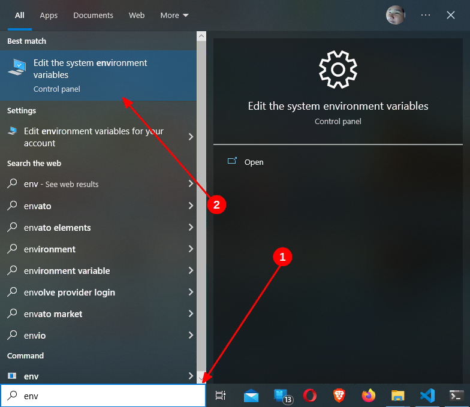
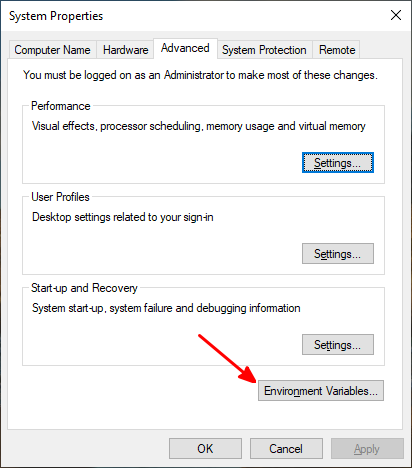
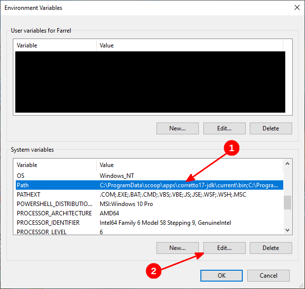
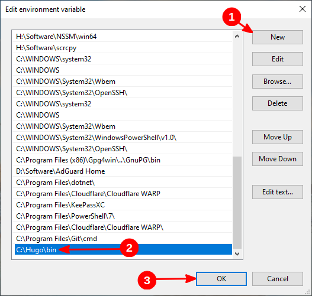

## Apa itu Hugo?

Hugo adalah salah satu SSG (_Static-site Generator_) atau Generator Web Statis yang dibuat menggunakan bahasa pemrograman Go, dikembangkan oleh Steve Francia, Bjørn Erik Pedersen, dan kontributor lainnya.

Hugo juga merupakan FLOSS (_Free/Libre Open Source Software_) yang dirilis di bawah [Lisensi Apache 2.0](https://github.com/gohugoio/hugo/blob/master/LICENSE), kode sumbernya bisa Anda akses [di sini](https://github.com/gohugoio/hugo).

Hugo mendukung berbagai _platform_ yang ada, termasuk sistem operasi Windows, macOS, berbasis Linux, dan BSD, untuk arsitektur x64 (disebut sebagai x86-64, x86_64 atau AMD64), ARM, dan ARM64. Hugo tidak lagi menyediakan berkas untuk arsitektur x86 (32-bit).

SSG ini diklaim sebagai SSG tercepat oleh para pengembangnya, salah satunya adalah karena Hugo berjalan di lingkungan yang _Native_, tanpa ketergantungan (_dependencies_) apa pun (kecuali kalau kamu mau dukungan CSS Sass) dan memiliki fitur yang dinamakan _Fast Render Mode_.

Selain itu, Hugo juga memiliki banyak fitur lainnya, seperti i18n untuk dukungan multibahasa, berkas data, berkas statis, pemrosesan gambar, pemrosesan berkas CSS, JS, dll yang dapat menunjang kebutuhan untuk Situs Web/Blog Anda.

## Varian Hugo

Saat ini Hugo memiliki 2 varian, yakni edisi standar tanpa dan dengan fitur **Deploy** (atau ada `withdeploy` di nama berkasnya) yang mana bisa kamu lakukan dengan perintah `hugo deploy` nantinya.

Fitur **Deploy** dari Hugo berguna untuk _men-deploy_ web statis ke layanan _storage_ seperti [AWS S3](https://aws.amazon.com/s3/), [Azure Blob Storage](https://azure.microsoft.com/en-us/products/storage/blobs/) dan [Google Cloud Storage](https://cloud.google.com/storage).

Karena pilihannya terbatas dan platform yang didukung sedikit, sebaiknya gunakan saja [Rclone](), yang secara fungsi dan fiturnya jauh lebih lengkap. Jadi, ketiadaan fitur Deploy di Hugo tidak masalah.

Sebelum versi `0.170.0`, Hugo juga memiliki dua edisi lain di luar edisi standar, yaitu **Extended** dan **Extended dengan Deploy** (`extended_withdeploy`). Keduanya mendukung CSS berbasis Sass dan diproses dengan [LibSass](https://github.com/sass/libsass).

Sayangnya LibSass tidak dikembangkan lagi, sehingga pengembang Hugo memutuskan untuk berganti ke [Dart Sass](https://github.com/sass/dart-sass) yang lebih baru.

Sebagai akibatnya, di versi `0.170.0` dan setelahnya kedua edisi itu resmi dihapus, walau sepertinya masih bisa dikompilasi.

Selain itu, untuk mengaktifkan dukungan Sass di Hugo edisi standar, Dart Sass harus diinstal sendiri oleh pengguna.

**Tapi kok masih ada Extended di perilisan?** Itu hanya sebagai _alias_ saja, atau dengan kata lain mereka adalah berkas yang sama dengan edisi standar. Tujuan adanya berkas-berkas tersebut adalah untuk menghindari gangguan konfigurasi yang sudah ada, seperti konfigurasi CI/CD, pengelola paket, dll, itu pun yang tersedia cuma berkas yang sering diunduh saja.

## Cara install Hugo

Di bagian ini, saya akan membahas cara instalasinya.

Caranya sendiri akan berbeda-beda untuk setiap sistem operasi ataupun _platform_ yang ada, jadi pastikan Anda mengikutinya sesuai dengan sistem operasi atau _platform_ yang digunakan.

Perlu dicatat bahwa Dart Sass adalah program yang terpisah dari Hugo meskipun Hugo menggunakannya jika diperlukan, sehingga harus diinstal sendiri dan tidak semua cara instalasi Hugo di sini sudah termasuk instalasi Dart Sass.

Dart Sass ikut terpasang hanya jika perintah instalasinya menyebut `sass` atau `dart-sass` secara eksplisit. Dart Sass bersifat opsional, jadi tidak menginstalnya pun tidak masalah selama tema yang dipakai tidak memakai Sass.

Berikut adalah cara instalasinya:

### Windows

#### Pengelola paket Scoop (direkomendasikan)

Anda dapat menginstal Hugo dan Dart Sass melalui [Scoop](https://scoop.sh) sebagai pengelola paket di Windows dengan perintah berikut:

```powershell
scoop install hugo sass
```

Perintah di atas akan menginstal Hugo dan Dart Sass di dalam direktori pengguna (`%USERPROFILE%\scoop\apps`), jika Anda ingin Hugo dan Dart Sass-nya dapat berjalan di semua pengguna, maka Anda perlu menambahkan argumen `-g`.

Perintahnya akan menjadi seperti berikut:

```powershell
scoop install hugo sass -g
```

Namun, Anda perlu membuka Command Prompt, Windows Terminal, PowerShell-nya, atau aplikasi terminal lainnya sebagai Administrator terlebih dahulu sebelum menjalankan perintah di atas.

Jika Anda sudah menginstal `sudo` melalui Scoop, [mengaktifkan `sudo` di Windows 11](https://learn.microsoft.com/en-us/windows/advanced-settings/sudo/) atau menginstal [`gsudo`](https://github.com/gerardog/gsudo) sebelumnya, maka cukup tambahkan saja `sudo` sebelum menjalankan perintah Scoop, tanpa harus menjalankan Terminal sebagai Administrator, menjadi seperti berikut:

```powershell
sudo scoop install hugo sass -g
```

Dengan begitu, Anda tidak perlu lagi membuka Terminal sebagai Administrator.

Untuk memperbarui versinya, silakan ganti opsi `install` di atas menjadi `update`. Kalau tidak butuh Dart Sass, cukup hapus saja `sass`-nya pada barisan perintah di atas.

#### Pengelola paket Chocolatey

Anda dapat menginstal Hugo dan Dart Sass melalui [Chocolatey](https://chocolatey.org/) sebagai pengelola paket di Windows dengan perintah berikut:

```powershell
choco install hugo sass
```

Perlu diketahui, paket `sass` di Chocolatey selalu mengikuti versi Dart Sass terbaru, tetapi ia bergantung pada paket `dart-sdk` sehingga SDK lengkapnya ikut terinstal. Unduhan SDK itu sekitar 210 MB, jauh lebih besar daripada kebutuhan Hugo dan Dart Sass saja.

Situs resmi Sass memang menyarankan `choco install sass`, jadi perintah di atas sah-sah saja. Namun, bila ukuran unduhan menjadi masalah, gunakan Scoop untuk memasang Dart Sass atau instal secara manual. Kalau tidak butuh Dart Sass, cukup hapus `sass` dari perintah di atas.

Untuk memperbarui versinya, silakan ganti opsi `install` di atas menjadi `upgrade`.


Secara baku, Chocolatey akan menginstal paket-paketnya di dalam direktori `%ProgramData%\chocolatey`, sehingga paket yang terinstal dapat diakses oleh semua pengguna di dalam 1 sistem.

Namun, direktori tersebut memerlukan izin Administrator untuk mengisinya. Oleh karena itu, Anda perlu membuka Command Prompt, Windows Terminal, PowerShell, atau aplikasi terminal lainnya sebagai Administrator sebelum menginstal, menghapus, dan memperbarui paket melalui Chocolatey.


#### Pengelola paket WinGet

Anda dapat menginstal Hugo melalui WinGet sebagai pengelola paket di Windows dengan perintah berikut:

```powershell
winget install -e --id Hugo.Hugo
```

Secara baku, perintah di atas akan menginstal Hugo di dalam direktori pengguna, jika Anda ingin Hugo-nya dapat berjalan di semua pengguna, maka Anda perlu menambahkan argumen `--scope machine`, contohnya seperti berikut:

```powershell
winget install -e --id Hugo.Hugo --scope machine
```

Namun, perlu diingat bahwa Anda perlu membuka Windows Terminal, Command Prompt, PowerShell, atau aplikasi terminal lainnya sebagai Administrator agar dapat menjalankan perintah dengan argumen di atas.

Anda tidak dapat menginstal Dart Sass menggunakan pengelola paket ini karena tidak tersedia, sehingga Anda perlu menginstalnya menggunakan pengelola paket lain, seperti Scoop dan Chocolatey, atau diinstal secara manual.

Untuk memperbarui versinya, silakan ganti opsi `install` di atas menjadi `upgrade`.

#### Berkas biner, tanpa pengelola paket (manual)

Hugo telah menyediakan berkas biner yang telah dikompilasi agar dapat digunakan secara langsung dan berkas tersebut diarsipkan dengan format/ekstensi `zip` (untuk Windows), jadi Anda bisa langsung menggunakannya setelah berkas tersebut diunduh dan diekstrak.

Maksud dari "berkas biner" di sini adalah berkas yang tujuannya untuk dieksekusi, kalau di Windows Anda akan mengenal dengan berkas yang berakhiran `.exe`.

Jika tidak ingin menggunakan pengelola paket apa pun untuk menginstalnya, maka berikut adalah langkah-langkahnya:

1. Unduh Berkas Arsip yang berisi berkas biner Hugo di [halaman perilisannya](https://github.com/gohugoio/hugo/releases).

    Di situ tersedia 4 berkas yang bisa Anda unduh salah satunya, semua itu diarsipkan dalam format Zip, sesuaikan dengan Arsitektur Sistem Operasi yang dipakai.

    Namun, jika Anda memakai Hugo sebelum versi `0.170.0` dan ingin menginstal edisi Extended, unduh berkas yang namanya diawali dengan `hugo_extended`

2. Setelah diunduh, ekstrak berkas arsip tersebut ke dalam folder/direktori apa saja.

    Saya asumsikan bahwa Anda mengekstraknya ke dalam Folder `C:\Hugo\bin` dan akan saya gunakan direktori tersebut untuk seterusnya

3. Setelah diekstrak, Anda perlu menambahkan ke dalam variabel `PATH` agar Hugo bisa dieksekusi di mana saja.

    Pertama-tama, klik "Start Menu", lalu manfaatkan fasilitas pencarian yang ada di sana atau Anda juga bisa langsung ke pencarian yang ada di _Taskbar_ jika Anda memasangkannya.

    Saat di pencarian, ketik `env` di situ, nanti akan muncul tulisan **Edit the system environment variables** dan klik tulisan tersebut, seperti cuplikan berikut:



4. Nanti akan muncul dialog **System Properties**, di dalam dialog tersebut, klik pada _Button_ **Environment Variables...**, seperti cuplikan berikut:



5. Setelah itu, Anda akan memasuki dialog yang berjudul **Environment Variables**, di situ nanti ada dua kolom, yakni **User variables** yang terletak di atas dan **System variables** yang terletak di bawah.

    Karena Variabel yang diubah ini lingkupnya ke satu Sistem Operasi, yang artinya semua Akun Pengguna (_User Account_) kena, maka carilah variabel `PATH` di dalam kolom **System variables**.

    Setelah ketemu, pilih variabel tersebut dan klik pada _Button_ **Edit**, seperti cuplikan berikut:



6. Anda memasuki dialog yang berjudul **Edit environment variables**, di situ Anda akan mengubah nilai dari variabel tersebut. Windows 10 dan Windows 7 mungkin memiliki penampilan yang berbeda, jadi cara mengubahnya akan berbeda-beda, berikut di bawah ini adalah caranya:

    - Di Windows 10 atau di atasnya: Nilai dari variabel `PATH` yang tampil di Windows 10 adalah dalam bentuk daftar. Untuk menambahkannya, cukup klik pada _Button_ **New**, lalu isi nilainya dengan lokasi berkas Hugo itu berada.

        Jika Anda sebelumnya mengekstrak Hugo di `C:\Hugo\bin`, maka isi nilainya dengan `C:\Hugo\bin` juga. Setelah menambahkannya, klik pada _Button_ **OK**, seperti cuplikan berikut:

        

    - Di Windows 7: Nilai dari Variabel `PATH` yang tampil di Windows 7 adalah dalam bentuk deretan. Untuk menambahkannya, cukup tambahkan `C:\Hugo\bin;` saja di bagian akhir deretan (**JANGAN DIGANTI SEMUA DERETANNYA!!**).

        `C:\Hugo\bin` menunjukkan tempat di mana Hugo diekstrak, jika Anda mengekstraknya di tempat lain, maka ganti `C:\Hugo\bin` menjadi lokasi di mana berkas biner Hugo itu berada.

        Setelah itu, klik pada _Button_ **OK**.

        **Catatan:** Mohon maaf, karena saya tidak lagi memakai Windows 7, jadi cuplikannya belum ada saat ini

7. Jika masih ada sesi Command Prompt, Windows Terminal, PowerShell, dll, maka Anda perlu menutup semuanya terlebih dahulu/mengakhiri semua sesinya, lalu membukanya kembali.

    Perubahan pada variabel `PATH` tidak berlaku di sesi terminal yang sudah terbuka. Jika belum ada terminal yang dibuka, bukalah salah satu (Command Prompt, Windows Terminal, PowerShell, dan sebagainya) sekarang.

8. Setelah Anda membuka Terminal-nya, silakan Anda eksekusikan perintah `hugo version` untuk menampilkan versi Hugo yang Anda gunakan. Jika berhasil, maka akan tampil keluaran seperti berikut:

```plain

```

9. Selamat! Anda telah berhasil menginstal Hugo. Jika Anda ingin memperbarui versi Hugo-nya, cukup unduh lagi berkas binernya, lalu tinggal timpakan berkas lamanya.

Langkah-langkah di atas juga dapat diikuti ketika Anda menginstal Dart Sass, paling berkas-berkas dan letak direktorinya saja yang berbeda, silakan kunjungi [halaman perilisan Dart Sass](https://github.com/sass/dart-sass/releases) jika Anda ingin mengunduhnya.

Nah, untuk Windows-nya saya cukupkan di sini dulu, berikutnya saya bahas cara instal Hugo untuk sistem operasi GNU/Linux.

### GNU/Linux {#gnu-linux}

#### Debian, Ubuntu, dan keluarganya

Jika Anda adalah pengguna Debian, Ubuntu atau keluarganya, sebenarnya Anda dapat menginstalnya dengan perintah berikut:

```shell
sudo sh -c 'apt update; apt install -y hugo'
```

Atau:

```shell
apt update; apt install -y hugo
```

Namun cara di atas tidak saya rekomendasikan, karena versi yang Anda dapatkan nantinya merupakan versi yang lama (kecuali jika Anda menggunakan distribusi dengan rilis bergulir).

Jika Anda ingin versi terbaru dari Hugo, silakan unduh itu di halaman [perilisan resminya](https://github.com/gohugoio/hugo/releases), pastikan unduh berkas `.deb`-nya, setelah itu tinggal Anda instal secara manual.

Atau, jika Anda lebih suka lewat Terminal, maka pertama-tama Anda perlu mengubah hak akses Anda di Terminal menjadi `root` dengan perintah `sudo su`, `sudo -i` atau `sudo -s`.

Setelah itu, tentukan apakah Anda mau menginstal Hugo varian standar atau Extended, beserta arsitektur sistem operasi yang Anda gunakan sekarang.

Jika sudah ditentukan, Anda bisa mengikuti caranya berikut:

Untuk menginstalnya, salinkan skrip berikut di bawah ini dan tempelkan itu ke dalam Terminal, lalu tekan "Enter":

```shell {linenos=true}
HUGO_VERSION="$(curl -fsSLIo /dev/null --retry 2 --connect-timeout 15 -w '%{url_effective}' "https://github.com/gohugoio/hugo/releases/latest" | sed -n 's#.*/tag/v*##p')"
HUGO_ARCH="$(dpkg --print-architecture)"
HUGO_FILENAME="hugo_"$HUGO_VERSION"_linux-"$HUGO_ARCH".deb"
cd /tmp; wget -c "https://github.com/gohugoio/hugo/releases/download/v$HUGO_VERSION/$HUGO_FILENAME"
```

Atau, gunakan skrip berikut jika Anda menggunakan `fish` sebagai _shell_:

```fish {linenos=true}
set HUGO_VERSION (curl -fsSLIo /dev/null --retry 2 --connect-timeout 15 -w '%{url_effective}' https://github.com/gohugoio/hugo/releases/latest | string match -rg '/tag/v*(.+)')
set HUGO_ARCH (dpkg --print-architecture)
set HUGO_FILENAME hugo_$HUGO_VERSION"_linux-$HUGO_ARCH.deb"
cd /tmp; wget -c "https://github.com/gohugoio/hugo/releases/download/v$HUGO_VERSION/$HUGO_FILENAME"
```

**Penjelasan:**

- Baris ke-1: Untuk mendapatkan versi terbaru Hugo, lalu memasukkannya ke dalam variabel `HUGO_VERSION`
- Baris ke-2: Untuk menentukan arsitektur sistem pada berkas Hugo yang ingin Anda unduh, variabel tersebut akan otomatis diisi berdasarkan hasil dari perintah `dpkg --print-architecture`.

    Anda bisa menggantinya kalau mau, arsitektur yang tersedia untuk Hugo adalah `amd64` dan `arm64`

- Baris ke-3: Untuk memasukkan Nama Berkas yang ingin diunduh ke dalam variabel `HUGO_FILENAME` dan Nilai tersebut diambil dari nama berkas Hugo aslinya, `HUGO_VERSION` untuk versi Hugo-nya dan `HUGO_ARCH` untuk arsitektur pada Hugo yang ingin diunduh
- Baris ke-4: Untuk menavigasikan Terminal ke `/tmp`, lalu mengunduh Hugo-nya di sana dengan bantuan GNU Wget

Lalu, instal berkas yang telah Anda unduh dengan perintah berikut:

```shell
dpkg -i "$HUGO_FILENAME" && echo "Instalasi berhasil" || echo "Instalasi Gagal"
rm -f "$HUGO_FILENAME"; cd -
```

**Penjelasan:**
Perintah di atas menginstal Hugo lewat `dpkg` dari berkas `.deb` yang namanya diambil dari variabel `HUGO_FILENAME`, lalu menampilkan pesan berhasil atau gagal. Apa pun hasilnya, berkas penginstal dihapus dan Terminal kembali ke direktori sebelumnya.

Semua cara di bagian ini tidak menyertakan Dart Sass, dan Dart Sass juga tidak tersedia sebagai berkas `.deb`. Gunakan pengelola paket lain seperti Homebrew, Snap, atau Nix, instal secara manual, atau pakai skrip yang telah tersedia.

Jika merasa sudah selesai, silakan alihkan kembali hak akses di dalam Terminal Anda menjadi pengguna biasa dengan perintah `exit`.

Untuk memperbarui versi Hugo-nya, Anda perlu mengulangi semua langkah-langkah di atas.

#### Fedora, CentOS, RHEL, dan keluarganya

Jika Anda adalah pengguna Fedora, CentOS, RHEL atau keluarganya, Anda dapat memasangnya dengan perintah berikut:

```shell {linenos=true}
sudo dnf install hugo
```

Versi yang didapat mungkin bukan yang terbaru, terutama untuk RHEL dan keluarganya. Untuk Fedora versi terbaru, paketnya biasanya sudah mendekati rilis terkini.

Dart Sass juga belum tersedia di repositori resmi Fedora dan keluarganya. Untuk memasangnya, gunakan Homebrew, Snap, atau Nix, instal secara manual, atau pakai skrip yang telah tersedia.

Kalau ingin Hugo versi terbaru sekaligus Dart Sass, gunakan Homebrew, Snap, atau Nix, atau instal secara manual.

#### openSUSE Leap/Tumbleweed dan keluarganya (tidak resmi)

Jika Anda adalah pengguna openSUSE Leap/Tumbleweed atau keluarganya, sebelum menginstalnya, tambahkan dulu repositori dari luar (dari [`home:dirkmueller:Factory`](https://build.opensuse.org/project/show/home:dirkmueller:Factory) untuk Hugo dan [`home:darix:apps`](https://build.opensuse.org/project/show/home:darix:apps) untuk Dart Sass, jadi itu bukan resmi) yang bisa Anda percayakan dengan salah satu perintah berikut:

```shell {linenos=true}
### Untuk pengguna openSUSE Leap 16
# Hugo
sudo zypper ar -f https://download.opensuse.org/repositories/home:dirkmueller:Factory/16.0/home:dirkmueller:Factory.repo

# Dart Sass
sudo zypper ar -f https://download.opensuse.org/repositories/home:darix:apps/16.0/home:darix:apps.repo

### Untuk pengguna openSUSE Tumbleweed
# Hugo
sudo zypper ar -f https://download.opensuse.org/repositories/home:dirkmueller:Factory/standard/home:dirkmueller:Factory.repo

### Catatan: pengguna openSUSE Tumbleweed tidak perlu menambahkan repositori karena Dart Sass sudah tersedia di repositori resmi
```

Setelah itu segarkan repositorinya, lalu install Hugo dan Dart Sass-nya dengan perintah berikut:

```shell {linenos=true}
sudo sh -c 'zypper ref; zypper in hugo dart-sass'
```

Untuk lebih lanjut, silakan kunjungi [halaman unduh repositorinya](https://software.opensuse.org/download.html?project=home%3Adirkmueller%3AFactory&package=hugo).

#### Arch Linux, Manjaro, dan keluarganya

Jika Anda adalah pengguna Arch Linux, Manjaro atau keluarganya, Anda dapat menginstal Hugo dan Dart Sass dengan perintah berikut:

```shell
sudo pacman -S hugo dart-sass
```

#### Solus dan keluarganya

Jika Anda menggunakan Solus atau keluarganya, maka Anda dapat menginstalnya dengan perintah berikut:

```shell
sudo eopkg install hugo
```

Anda tidak dapat menginstal Dart Sass menggunakan repositori resminya, karena memang belum tersedia, silakan gunakan pengelola paket lain seperti Snap, Homebrew atau pengelola paket Nix, atau instal manual, atau bisa juga menggunakan skrip yang tersedia bila tidak mau ribet.

#### Void Linux dan keluarganya

Jika Anda adalah pengguna Void Linux atau keluarganya, Anda dapat menginstal Hugo dengan perintah berikut:

```shell
sudo xbps-install -S hugo
```

Anda tidak perlu khawatir mengenai arsitektur sistem yang Anda gunakan, karena paketnya mendukung itu semua, sehingga bisa diinstal di arsitektur sistem manapun di Void Linux.

Dart Sass juga belum tersedia di repositori resmi Void Linux. Gunakan Homebrew atau Nix, instal secara manual, atau pakai skrip yang telah tersedia.

#### Homebrew (lebih universal) {#homebrew-lebih-universal}

Jika Anda ingin menggunakan [Homebrew (brew)](https://brew.sh/) yang lebih universal, maka Anda bisa menginstal Hugo dan Dart Sass-nya dengan perintah berikut:

```shell
brew install hugo dart-sass
```

Hapus salah satu nama paket dari barisan perintah untuk menginstal salah satunya. Contohnya bila Anda sudah menginstal Hugo dengan metode lain dan hanya ingin menginstal Dart Sass saja, maka cukup hapus saja `hugo` di barisan perintah di atas.

#### Snap (lebih universal)

Jika Anda ingin menggunakan Snap yang lebih universal, maka Anda dapat menginstal Hugo dan Dart Sass-nya dengan perintah berikut:

```shell
sudo snap install hugo dart-sass
```

Untuk memasang salah satunya saja, hapus nama paket yang tidak dibutuhkan dari perintah di atas.


Kalau dibilang 'Universal' mungkin tidak terlalu, semenjak Snap sendiri memasukkan systemd sebagai ketergantungan, sehingga distribusi yang Anda gunakan harus memakai systemd sebagai init agar Snap bisa digunakan.

Jika Anda menggunakan distribusi yang tidak memakai systemd seperti Void Linux, Devuan, MX Linux (lebih tepatnya ia tidak menggunakannya sebagai "Init baku"), Artix Linux, Guix dan keluarganya dan lainnya, maka kemungkinan besar Anda tidak dapat menggunakan pengelola paket Snap.

Makanya di awal saya bilang "lebih universal", karena bisa untuk distribusi lainnya yang lebih luas ketimbang menggunakan pengelola paket bawaan.


#### Pengelola paket Nix (lebih universal)

Jika Anda ingin menggunakan [Pengelola Paket Nix](https://nixos.org/) yang lebih universal, sebelum benar-benar menginstalnya, Anda bisa mencobanya terlebih dahulu dengan menggunakan perintah berikut:

```shell
nix-shell -p hugo dart-sass
```

Perintah di atas akan tetap menginstal Hugo dan Dart Sass, tapi di dalam `nix-shell` khusus, sehingga setelah masuk ke sana Hugo dan Dart Sass hanya bisa dijalankan dari situ.

Jadi, jika Anda menginstalnya dengan perintah di atas, agar Hugo dapat dijalankan sewaktu-waktu, maka Anda harus masuk ke dalam `nix-shell` terlebih dahulu dengan mengeksekusi perintah di atas.

Cara ini cocok untuk menguji aplikasi sebelum dipasang permanen. Nix sendiri justru menyarankan `nix-shell` ketimbang instalasi permanen, kecuali Anda memakai NixOS yang aplikasinya dipasang lewat berkas konfigurasi sistem.

Namun, jika Anda ingin menginstalnya secara permanen, maka Anda bisa menginstalnya dengan perintah berikut:

```shell
nix-env -iA nixpkgs.hugo nixpkgs.dart-sass
```

Untuk memasang salah satunya saja, hapus nama paket yang tidak dibutuhkan dari perintah di atas.

Aturan ini berlaku bagi pengguna Nix di luar NixOS. Jika Anda pengguna NixOS, ganti `nixpkgs` menjadi `nixos`.

Namun, jika Anda tidak menggunakan NixOS dan menggunakan Nix sebagai pengelola paket, maka versi paket yang Anda dapatkan biasanya akan mengikuti kanal tidak stabil dari NixOS/Nixpkgs.

#### Penyebutan khusus: instalasi Dart Sass menggunakan skrip (lebih universal)

Saya sudah menyediakan skrip instalasi Dart Sass untuk distribusi yang tidak menyediakannya, baik versinya ketinggalan maupun paketnya tidak ada sama sekali.

Untuk melihat atau/dan mengunduh skripnya, silakan kunjungi file yang bernama [`install-dart-sass.sh`](https://github.com/FarrelF/Blog/blob/main/scripts/install-dart-sass.sh).

Skrip tersebut tidaklah sepenuhnya dibuat oleh saya, melainkan AI yang membuat skrip tersebut, jadi mohon baca (kalau bisa pahami) terlebih dahulu kodenya sebelum menjalankan skrip tersebut.

Tapi harusnya tidak masalah, karena saya yakin tidak ada kode yang membahayakan di situ dan saya menggunakannya untuk Netlify dan Cloudflare Pages.

Jika sudah yakin, Anda bisa mengunduh, lalu mengeksekusi skripnya dengan cara berikut:

```shell {linenos=true}
curl -fsSLO https://raw.githubusercontent.com/FarrelF/Blog/refs/heads/main/scripts/install-dart-sass.sh
chmod +x ./install-dart-sass.sh
sudo ./install-dart-sass.sh [versi]
```

Hapus `[versi]` di atas untuk menginstal Dart Sass versi terbaru atau ganti `[versi]` dengan versi Dart Sass yang Anda inginkan.

Secara baku, Dart Sass akan terinstal di dalam direktori `/usr/local/bin` karena skrip tersebut dieksekusi dengan hak akses `root` ataupun menggunakan `sudo`, jika tidak menggunakan hak akses `root` maka secara otomatis akan terinstal di dalam direktori `$HOME/.local/bin`.

Mengapa bagian ini termasuk "Penyebutan khusus" adalah bahwa skrip tersebut dibuat dengan tujuan membantu instalasi di Netlify dan Cloudflare Pages, walau harusnya bisa juga untuk umum, tapi belum terlalu matang, jadi silakan dicoba.

Karena skrip tersebut juga berbasis Bash, bukan POSIX shell, maka mungkin ada sebagian distribusi/sistem operasi yang tidak kompatibel dengan skrip ini, tapi harusnya sebagian besar distribusi GNU/Linux sudah kompatibel dengan ini.

Untuk Android melalui Termux juga belum didukung oleh skrip ini, mungkin ke depan akan ditambahkan sekalian skrip _installer_ Hugo-nya.

#### Berkas biner, tanpa pengelola paket (lebih universal, manual)

Hugo telah menyediakan berkas biner yang telah dikompilasi agar dapat digunakan secara langsung dan berkas tersebut diarsipkan dengan format/ekstensi `.tar.gz` (untuk GNU/Linux), jadi Anda bisa langsung menggunakannya setelah berkas tersebut diunduh dan diekstrak.

Maksud dari "berkas biner" di sini adalah berkas yang tujuannya untuk dieksekusi, kalau di Windows Anda akan mengenal dengan berkas yang berakhiran `.exe`.

Berkas tersebut biasanya akan kompatibel dengan hampir seluruh distribusi GNU/Linux, jadi jika distribusi yang Anda gunakan tidak saya bahas di sini dan tidak mau menggunakan pengelola paket yang universal atau bahkan sama sekali tidak mau menggunakan pengelola paket, maka Anda bisa gunakan berkas binernya.

Cara sederhananya:

1. Unduh salah satu berkas Arsip yang berisikan berkas biner Hugo dari [halaman perilisannya](https://github.com/gohugoio/hugo/releases) (yang berformat `.tar.gz`)
2. Ekstrak berkasnya
3. Izinkan agar berkas yang bernama `hugo` bisa dieksekusi (dengan mengeksekusi perintah `chmod +x hugo`)
4. Pindahkan berkas yang bernama `hugo` ke dalam direktori `/usr/local/bin` (dengan mengeksekusi perintah `sudo mv hugo /usr/local/bin/`)
5. Pastikan bahwa `/usr/local/bin/hugo` itu milik pengguna `root` (dengan mengeksekusi perintah `sudo chown root:root /usr/local/bin/hugo`)
6. Selesai!

Langkah yang kurang lebih sama berlaku untuk Dart Sass; hanya halaman rilis, direktori, dan cara ekstraknya yang berbeda.

Untuk mengunduhnya, silakan kunjungi [halaman perilisannya](https://github.com/sass/dart-sass/releases), unduh dan ekstrak, setelah diekstrak, pindahkan folder `src` dan berkas `sass` di dalam folder `dart-sass` langsung ke direktori `/usr/local/bin`.

Lalu, jalankan `sudo chmod +x /usr/local/bin/sass` dan `sudo chown -R root:root /usr/local/bin/sass /usr/local/bin/src`. Udah deh selesai!

**Catatan:** Bisa saja Anda memindahkan berkas tersebut ke dalam direktori lain yang termasuk dalam variabel `PATH`, seperti `/home/username/.local/bin` misalnya dan tidak perlu melakukan peralihan kepemilikan ke `root`, tapi saya rekomendasikan agar diletakkan ke dalam direktori `/usr/local/bin` supaya Hugo dan Dart Sass bisa dieksekusi oleh seluruh pengguna di satu sistem.

Jika Anda lebih suka melakukannya secara langsung di Terminal (atau cara panjangnya) maka pertama-tama Anda perlu mengubah hak akses Anda di Terminal menjadi `root` dengan perintah `sudo su`, `sudo -i`, atau `sudo -s`, kecuali jika Anda ingin menginstalnya di dalam direktori pengguna.

Setelah itu, tentukan arsitektur sistem operasi apa yang Anda gunakan sekarang.

Jika sudah ditentukan, Anda bisa mengikuti caranya berikut:

Untuk menginstalnya, maka tinggal Anda copas saja skrip berikut ke dalam Terminal, lalu tekan "Enter":

```shell {linenos=true}
HUGO_VERSION=$(curl -fsSLIo /dev/null --retry 2 --connect-timeout 15 -w '%{url_effective}' https://github.com/gohugoio/hugo/releases/latest | sed -n 's#.*/tag/v*##p')
DART_SASS_VERSION=$(curl -fsSLIo /dev/null --retry 2 --connect-timeout 15 -w '%{url_effective}' https://github.com/sass/dart-sass/releases/latest | sed -n 's#.*/tag/v*##p')
HUGO_ARCH=amd64 DART_SASS_ARCH=x64
HUGO_FILENAME=hugo_${HUGO_VERSION}_linux-$HUGO_ARCH.tar.gz DART_SASS_FILENAME=dart-sass-$DART_SASS_VERSION-linux-$DART_SASS_ARCH.tar.gz
INSTALL_TEMPDIR=$(mktemp -d); cd "$INSTALL_TEMPDIR" && wget -c "https://github.com/gohugoio/hugo/releases/download/v$HUGO_VERSION/$HUGO_FILENAME" "https://github.com/sass/dart-sass/releases/download/$DART_SASS_VERSION/$DART_SASS_FILENAME"
printf '%s\n' *.tar.gz | xargs -n1 -P2 tar -xzf
install -Dm755 hugo /usr/local/bin/; install -Dm644 LICENSE /usr/share/licenses/hugo/LICENSE
install -Dm755 dart-sass/sass /usr/local/bin/; mv dart-sass/src /usr/local/bin/dart-sass; chown -R root:root /usr/local/bin/dart-sass
sed -i '/^exec /s|/src/|/dart-sass/|g' /usr/local/bin/sass
cd -
rm -rf "$INSTALL_TEMPDIR"
```

Atau, gunakan skrip berikut jika Anda menggunakan `fish` sebagai _shell_:

```fish {linenos=true}
set HUGO_VERSION (curl -fsSLIo /dev/null --retry 2 --connect-timeout 15 -w '%{url_effective}' https://github.com/gohugoio/hugo/releases/latest | string match -rg '/tag/v*(.+)')
set DART_SASS_VERSION (curl -fsSLIo /dev/null --retry 2 --connect-timeout 15 -w '%{url_effective}' https://github.com/sass/dart-sass/releases/latest | string match -rg '/tag/v*(.+)')
set HUGO_ARCH amd64; set DART_SASS_ARCH x64
set HUGO_FILENAME hugo_$HUGO_VERSION"_linux-$HUGO_ARCH.tar.gz"; set DART_SASS_FILENAME dart-sass-$DART_SASS_VERSION"-linux-$DART_SASS_ARCH.tar.gz"
set INSTALL_TEMPDIR (mktemp -d); cd $INSTALL_TEMPDIR; wget -c "https://github.com/gohugoio/hugo/releases/download/v$HUGO_VERSION/$HUGO_FILENAME" "https://github.com/sass/dart-sass/releases/download/$DART_SASS_VERSION/$DART_SASS_FILENAME"
printf '%s\n' *.tar.gz | xargs -n1 -P2 tar -xzf
install -Dm755 hugo /usr/local/bin/; install -Dm644 LICENSE /usr/share/licenses/hugo/LICENSE
install -Dm755 dart-sass/sass /usr/local/bin/; mv dart-sass/src /usr/local/bin/dart-sass; chown -R root:root /usr/local/bin/dart-sass
sed -i '/^exec /s|/src/|/dart-sass/|g' /usr/local/bin/sass
cd -
rm -rf $INSTALL_TEMPDIR
```

**Penjelasan:**

- Baris ke-1: Untuk mendapatkan versi terbaru Hugo dari tujuan akhir pengalihan (redirect) halaman `releases/latest` di GitHub, lalu memasukkannya ke dalam variabel `HUGO_VERSION`. Awalan `v` pada tag otomatis dibuang oleh `string match`
- Baris ke-2: Untuk mendapatkan versi terbaru Dart Sass dengan cara yang sama, lalu memasukkannya ke dalam variabel `DART_SASS_VERSION`
- Baris ke-3: Untuk menentukan arsitektur sistem pada berkas Hugo dan Dart Sass yang ingin Anda unduh, secara baku diisi `amd64` (variabel `HUGO_ARCH`) dan `x64` (variabel `DART_SASS_ARCH`), yang artinya Anda akan mengunduh berkas untuk arsitektur `AMD64` atau `x86_64`. Sesuaikan dengan arsitektur sistem operasi yang Anda gunakan
- Baris ke-4: Untuk memasukkan Nama Berkas yang ingin diunduh ke dalam variabel `HUGO_FILENAME` dan `DART_SASS_FILENAME`, dengan nilai yang diambil dari nama berkas aslinya, yakni adanya versi (`HUGO_VERSION`/`DART_SASS_VERSION`) dan arsitektur (`HUGO_ARCH`/`DART_SASS_ARCH`)
- Baris ke-5: Untuk membuat direktori sementara dengan `mktemp -d` dan menyimpan lokasinya di variabel `INSTALL_TEMPDIR`, menavigasikan Terminal ke sana, lalu mengunduh Hugo dan Dart Sass sekaligus dengan bantuan GNU Wget. Opsi `-c` membuat unduhan bisa dilanjutkan bila terputus
- Baris ke-6: Untuk mengekstrak kedua berkas arsip `.tar.gz` secara paralel (dua proses sekaligus) dengan bantuan `xargs`
- Baris ke-7: Untuk menginstal `hugo` di direktori `/usr/local/bin` dengan chmod `755`, lalu menyalin berkas `LICENSE` milik Hugo ke `/usr/share/licenses/hugo/LICENSE` dengan chmod `644`
- Baris ke-8: Untuk menginstal `sass` di direktori `/usr/local/bin` dengan chmod `755`, memindahkan direktori `src` milik Dart Sass ke `/usr/local/bin/dart-sass`, lalu menyetel pemilik direktori tersebut menjadi `root:root`
- Baris ke-9: Untuk mengubah jalur `/src/` menjadi `/dart-sass/` pada baris `exec` di berkas `/usr/local/bin/sass`, agar skrip `sass` menunjuk ke lokasi baru Dart Sass. Opsi `-i` mengubah berkas langsung di tempat
- Baris ke-10: Kembali ke direktori sebelumnya
- Baris ke-11: Menghapus direktori sementara beserta berkas unduhan dan hasil ekstrak yang sudah tak terpakai lagi

Setelah itu, pastikan kalau Hugo dapat berjalan dengan mengeksekusi perintah berikut untuk melihat versi Hugo yang Anda gunakan sekarang:

```shell
hugo version
```

Jika berhasil, maka keluarannya akan seperti di bawah ini:

```plain

```

Masih dalam hak akses `root`, kalau mau, Anda juga dapat membuat halaman panduan (manpages) untuk Hugo dengan skrip berikut:

```shell {linenos=true}
hugo gen man --dir '/tmp/hugo_manpages'
cd /tmp/hugo_manpages; gzip -9 *
install -Dm644 * -t /usr/local/man/man1
cd -; rm -rf /tmp/hugo_manpages
```

**Penjelasan:**

- Baris ke-1: Untuk membuat Halaman Panduan Hugo dan berkas-berkasnya akan diletakkan di dalam direktori `/tmp/hugo_manpages` (Direktori tersebut akan dibuatkan secara otomatis jika tidak ada, jadi Anda tidak perlu membuatnya terlebih dahulu)
- Baris ke-2: Untuk menavigasikan _shell_ ke dalam direktori `/tmp/hugo_manpages`, lalu mengkompresi semua berkas di dalamnya dengan Gzip dan menghapus semua berkas aslinya
- Baris ke-3: Untuk menyalin semua berkas di dalamnya ke `/usr/local/man/man1` dan menyetel nilai chmod-nya ke `644`
- Baris ke-4: Untuk kembali ke direktori sebelumnya, lalu menghapus direktori `/tmp/hugo_manpages` dan seluruh berkas di dalamnya (atau secara rekursif)

Kalau sudah, Anda bisa tes halaman panduannya dengan mengeksekusi perintah `man hugo` di dalam Terminal Anda.

Jika Anda ingin memasang fitur _Completion_ untuk _Shell_ yang Anda gunakan di Terminal, maka Anda dapat memasangnya dengan perintah berikut: (Sesuaikan dengan _Shell_ yang ter-install di sistem Anda)

```shell {linenos=true}
### Untuk pengguna Bash
hugo completion bash | install -Dm644 /dev/stdin "/usr/share/bash-completion/completions/hugo"

### Untuk pengguna Zsh
hugo completion zsh | install -Dm644 /dev/stdin "/usr/share/zsh/site-functions/_hugo"

### Untuk pengguna fish
hugo completion fish | install -Dm644 /dev/stdin "/usr/share/fish/vendor_completions.d/hugo.fish"
```

Silakan coba fitur _Completion_ di dalam Terminal Anda setelah itu.

Jika merasa sudah selesai, silakan alihkan kembali hak akses di dalam Terminal Anda menjadi Pengguna Biasa dengan perintah `exit`.

Untuk memperbarui versi Hugo-nya, Anda perlu mengulangi semua langkah-langkah di atas.

### macOS

#### Berkas penginstal

**Catatan:** Saya tidak memakai sistem operasi macOS, mungkin cara instalasi yang saya lontarkan di sini kurang begitu akurat sehingga bisa saja salah. Jika terjadi kesalahan, mohon berikan masukan/koreksi dari Anda melalui kolom komentar.

Anda dapat menginstal Hugo menggunakan berkas penginstal yang disediakan secara resmi jika Anda menggunakan macOS.

Cukup unduh berkasnya di [halaman perilisannya](https://github.com/gohugoio/hugo/releases) yang biasanya berkas tersebut berekstensi `.pkg`, lalu buka berkasnya.

Setelah dibuka maka penginstal akan muncul, cukup ikuti saja langkahnya, lalu masukkan kata sandi Administrator bila perlu. Hugo pun langsung terinstal setelah itu.

Perlu diingat bahwa ini tidaklah menginstal Dart Sass, Anda dapat menginstalnya menggunakan pengelola paket Homebrew/`brew`.

#### Homebrew

Homebrew tersedia untuk macOS maupun GNU/Linux. Perintah instalasinya sama dengan bagian [Homebrew di GNU/Linux](#homebrew-lebih-universal).

#### MacPorts

**Catatan:** Saya tidak memakai sistem operasi macOS dan MacPorts sebagai pengelola paket, mungkin cara instalasi yang saya lontarkan di sini kurang begitu akurat sehingga bisa saja salah. Jika terjadi kesalahan dan Anda adalah pengguna MacPorts, mohon berikan masukan/koreksi dari Anda melalui kolom komentar.

Jika Anda menggunakan [MacPorts](https://www.macports.org/) sebagai Pengelola Paket di dalam macOS Anda, maka Anda dapat menginstal Hugo dengan perintah berikut:

```shell
sudo port install hugo
```


Jika Anda tidak ingin menggunakan `sudo`, maka hapus saja `sudo`-nya.

### Android

#### Termux

Jika Anda menggunakan [Termux](https://termux.com/) di dalam Android, maka Anda dapat menginstal Hugo dengan perintah berikut:

```shell
pkg i hugo
```

Saya sarankan agar Anda menggunakan Termux versi terbaru untuk pengalaman yang lebih nyaman, bisa Anda unduh di [F-Droid](https://f-droid.org/en/packages/com.termux/), [GitHub](https://github.com/termux/termux-app/releases) atau [Google Play Store (eksperimental)](https://play.google.com/store/apps/details?id=com.termux). Perlu versi Android minimal 7.0 agar Termux versi terbaru dapat digunakan.

### BSD

#### OpenBSD dan keluarganya

**Catatan:** Saya tidak memakai sistem operasi berbasis BSD, seperti OpenBSD, mungkin cara instalasi yang saya lontarkan di sini kurang begitu akurat sehingga bisa saja salah. Jika terjadi kesalahan dan Anda adalah pengguna OpenBSD, mohon berikan masukan/koreksi dari Anda melalui kolom komentar.

Jika Anda adalah pengguna OpenBSD dan keluarganya, maka Anda dapat menginstal Hugo dengan perintah berikut:

```shell
doas pkg_add hugo
```

#### NetBSD dan keluarganya

**Catatan:** Saya tidak memakai sistem operasi berbasis BSD, seperti NetBSD, mungkin cara instalasi yang saya lontarkan di sini kurang begitu akurat sehingga bisa saja salah. Jika terjadi kesalahan dan Anda adalah pengguna OpenBSD, mohon berikan masukan/koreksi dari Anda melalui kolom komentar.

Jika Anda adalah pengguna NetBSD dan keluarganya, maka Anda dapat menginstal Hugo dengan perintah berikut:

```shell
sudo pkgin install go-hugo
```

#### FreeBSD, DragonFly BSD, dan keluarganya

**Catatan:** Saya tidak memakai sistem operasi berbasis BSD, seperti FreeBSD dan DragonFly BSD, mungkin cara instalasi yang saya lontarkan di sini kurang begitu akurat sehingga bisa saja salah. Jika terjadi kesalahan dan Anda adalah pengguna FreeBSD dan DragonFly BSD, mohon berikan masukan/koreksi dari Anda melalui kolom komentar.

Jika Anda adalah pengguna FreeBSD, DragonFly BSD dan keluarganya, maka Anda dapat menginstal Hugo dengan perintah berikut:

```shell
sudo pkg install gohugo
```

### Docker

Jika Anda menggunakan Docker, mungkin Anda bisa gunakan _Docker Image_ [`hugomods/hugo`](https://hub.docker.com/r/hugomods/hugo) untuk itu. Ini memang bukan dari pengembang resmi, tapi ini yang paling aktif.

Untuk penjelasan lebih lanjut, silakan kunjungi [situs web resminya](https://docker.hugomods.com).

## Pertanyaan dan jawaban

### Pertanyaan ke-1: varian Hugo mana yang harus dipakai? {#pertanyaan-ke1}

**Jawab:** Sebaiknya edisi standar tanpa fitur **Deploy**, karena pilihannya terbatas dan secara fungsi tidak lebih baik daripada memakai Rclone.

Akan lebih baik kalau Dart Sass terinstal, mengingat banyak tema yang menggunakan Sass juga, tapi sayangnya tidak semua cara instalasi di sini bisa menyertakan instalasi Dart Sass.

### Pertanyaan ke-2: kenapa cara instal Hugo di Fedora, Red Hat, dan keluarganya dulu tidak dibahas? {#pertanyaan-ke2}

**Jawab:** ~~Karena versi Hugo yang digunakan oleh Fedora, Red Hat, dan Keluarganya adalah versi lama.~~

~~Hingga saat ini, saya belum menemukan repositori luar yang cocok untuk Fedora, Red Hat, dan Keluarganya.~~

~~Jika Anda sangat ingin menginstal Hugo di dalam Distribusi yang tidak saya bahas, maka saya sarankan agar Anda menginstalnya melalui cara yang lebih "Universal" seperti menggunakan Snap, Homebrew, Nix atau melalui cara manual (mengunduh berkas biner, tanpa pengelola paket).~~

**Pembaruan (7 Juni 2023):** Sekarang cara instal untuk Fedora, CentOS, RHEL, dan keluarganya sudah saya bahas, sehingga pertanyaan ini tidak berlaku lagi.

### Pertanyaan ke-3: apakah cara instal untuk openSUSE bisa diaplikasikan di Fedora, Red Hat, dan keluarganya? {#pertanyaan-ke3}

**Jawab:** Tidak bisa, kalaupun bisa maka sebaiknya jangan, karena pada dasarnya distribusi keluarga SUSE dan Fedora/Red Hat memang berbeda meskipun sama-sama menggunakan RPM sebagai salah satu sistem pengelolaan paketnya dan sama-sama merupakan GNU/Linux.

Letak perbedaannya nanti di paket ketergantungannya, mulai dari nama paketnya sampai versi dari paket-paket tersebut yang didapat akan berbeda satu sama lain.

Jika Anda ingin mencobanya ya silakan saja, tapi segala risiko yang ada atau yang telah terjadi, silakan Anda tanggung sendiri.

## Penutup

Sudah? Iya, sudah, cuma itu saja yang perlu Anda lakukan. Ini merupakan artikel yang membahas tentang 'Cara Install Hugo', bukan 'Cara Install Hugo beserta konfigurasinya', walaupun saya sedikit berbasa-basi tentang apa itu Hugo dan apa saja variannya.

Demi kesederhanaan Artikel ini, maka topik tentang membuat Blog di Hugo beserta konfigurasinya akan saya bahas secara terpisah.

Jika kamu mempunyai pertanyaan, kritik dan saran, komentar atau masukan lainnya, silakan kamu berkomentar melalui kolom komentar yang tersedia atau bisa kamu [Hubungi Saya](/tentang).

Terima kasih atas perhatiannya 😊
